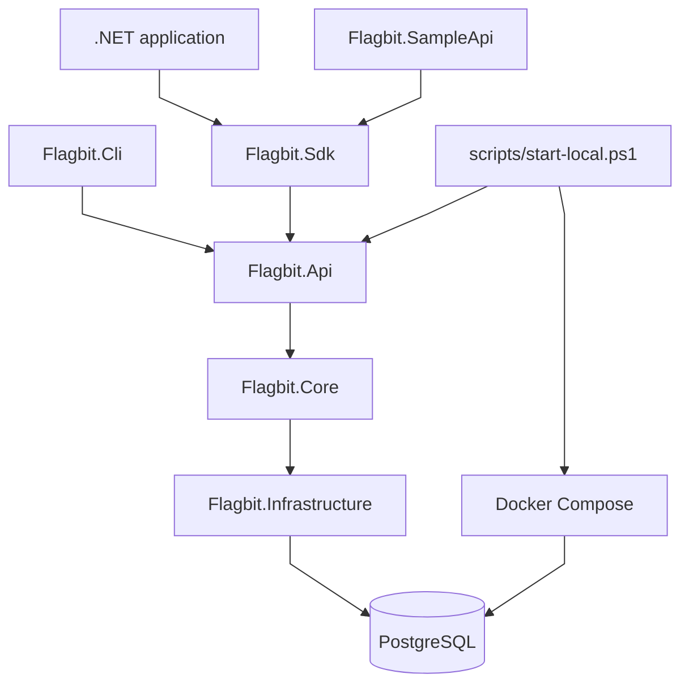
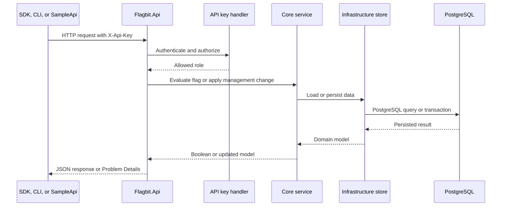

# Flagbit

Flagbit is a functioning, deliberately scoped feature flag service for .NET applications. It provides centralized flag management and runtime evaluation without rebuilding or redeploying the consuming application, with user targeting, percentage rollouts, environments, rules, schedules, and dependencies.

## Technology

Flagbit is built with C# and .NET 10. It uses ASP.NET Core for its HTTP API, Entity Framework Core for persistence, and provides a reusable .NET SDK. Tests are written with xUnit, with Testcontainers used for PostgreSQL integration coverage.

## Local server scope

The local server supports flag creation, listing, retrieval, evaluation-setting updates, deletion, enable/disable operations, and evaluation with user, environment, and attribute context. PostgreSQL stores definitions and settings across API restarts. HTTP and CLI access work without the SDK; advanced settings are managed over HTTP.

API keys are required in the current version. The SDK and SampleApi are optional clients. A dashboard, user accounts, multiple projects, Redis, and real-time updates are outside the current local server scope.

| Component | Responsibility |
| --- | --- |
| `Flagbit.Api` | HTTP management, evaluation, authentication, health, OpenAPI, and migration startup integration. |
| `Flagbit.Core` | Flag validation, matching, rollout bucketing, schedule, and dependency evaluation. |
| `Flagbit.Infrastructure` | PostgreSQL persistence and EF Core migrations. |
| `Flagbit.Sdk` | Optional HTTP evaluation client with caller-owned context, variations, `HttpClient`, cancellation, and failure policy. |
| `Flagbit.Cli` | SDK-free management and contextual evaluation commands. |
| `Flagbit.SampleApi` | A small application that demonstrates one contextual evaluation per checkout request. |

See the [HTTP API guide](docs/http-api.md) for endpoint contracts, the SDK-free PowerShell walkthrough, evaluation behavior, OpenAPI, health and migration boundaries, and Problem Details responses. See the [Sample API guide](samples/Flagbit.SampleApi/README.md) for a complete consumer demonstration.

## Project maps

The [project definition](docs/project-definition.md) records the completed scope, module responsibilities, and deliberate boundaries. The maps below use straight arrows and reflect the current implementation.

### Flow map

Applications evaluate flags through the API; Core applies the evaluation contract and Infrastructure persists the data in PostgreSQL. The local startup script prepares that database before the API becomes ready.



See the [flow map](docs/flow-map.md) for the full component, startup, and evaluation-decision paths.

### Request map

Every protected evaluation or management request is authenticated before the API evaluates a flag or persists a change. The SDK, CLI, and SampleApi remain HTTP clients; the server owns evaluation and persistence.



See the [request map](docs/request-map.md) for endpoint access, generated-key lookup, complete evaluation, management, and startup request sequences. See the [HTTP API guide](docs/http-api.md) for the complete contract and executable examples.

## PostgreSQL

PostgreSQL is used to persist feature flag definitions, enabled states, targeting and rollout settings, environments, evaluation rules, schedules, and dependencies. EF Core and Npgsql provide database access and migration support, while Docker is used for the local PostgreSQL environment during development.

Apply migrations before starting the updated API. The identifier-normalization migration converts the existing generated lookup columns to application-owned values and backfills them using Core's ordinal case-insensitive identity rules. It retains original identifiers, flag IDs, settings, and generated API keys. Stop older API instances before applying this migration because they rely on database-generated lookup values.

## Prerequisites and local startup

Install the .NET 10 SDK and Docker Desktop with Linux containers, and start Docker Desktop. The local workflow was rehearsed on Windows 11 with Windows PowerShell 5.1; the GitHub Actions workflow validates the same solution on Ubuntu with Docker. From the repository root, copy `.env.example` to `.env` if you do not already have one, then set its PostgreSQL credentials. Existing PostgreSQL volumes retain their original credentials; changing `.env` does not change the database password.

Set two different API keys in your PowerShell terminal and run the startup script:

```powershell
$env:ApiKeys__ManagementKey = "<your-management-api-key>"
$env:ApiKeys__EvaluationKey = "<your-evaluation-api-key>"
.\scripts\start-local.ps1
```

The script starts PostgreSQL, waits for its Compose health check, restores the local EF tool, builds the API, applies migrations, and starts the API in Development. It reports readiness only after `/health` returns `200`. Migration or startup failures stop the sequence. Database settings come from the resolved Compose configuration, so a separate development connection-string edit is unnecessary. `/health` checks database connectivity only; it does not prepare or validate the migration state by itself.

The default API address is `http://localhost:5070`. Use `.\scripts\start-local.ps1 -Port 5071` to select another port. API output is written to `artifacts/local/api-<port>.log` and `api-<port>.error.log`. Keep the terminal open; Ctrl+C stops the API while leaving PostgreSQL and its persistent data available. You can stop PostgreSQL separately with `docker compose stop postgres`.

For a manual or IDE launch, run `.\scripts\start-local.ps1 -PrepareOnly` after setting the same keys. This runs the same PostgreSQL preparation, build, and migrations, then leaves `ConnectionStrings__PostgreSQL`, `ASPNETCORE_ENVIRONMENT`, `DOTNET_ENVIRONMENT`, and `ASPNETCORE_URLS` set in the current terminal without starting the API. Run `dotnet run --project .\src\Flagbit.Api --launch-profile http`, or launch a new IDE process from that terminal and select the API's `http` profile. An already-running IDE does not inherit the prepared environment. The API has no separate development connection-string fallback.

Preparation-only mode intentionally retains those environment values; ordinary startup restores their previous values on exit or Ctrl+C. Use `-EnvFile <path>` for a separate PostgreSQL environment file. Both applications remain native .NET processes; Compose runs PostgreSQL only. See the [local workflow verification notes](docs/local-workflow-verification.md) for isolated startup, IDE configuration, restart checks, and the operating system and shell verified.

In a second terminal, configure the CLI and try the management flow:

```powershell
$env:FLAGBIT_API_URL = "http://localhost:5070"
$env:FLAGBIT_API_KEY = "<your-management-api-key>"
dotnet run --project .\src\Flagbit.Cli -- create local-checkout
dotnet run --project .\src\Flagbit.Cli -- get local-checkout
dotnet run --project .\src\Flagbit.Cli -- enable local-checkout
dotnet run --project .\src\Flagbit.Cli -- evaluate local-checkout --user user-123 --environment production --attribute plan=enterprise
dotnet run --project .\src\Flagbit.Cli -- delete local-checkout
```

The CLI supports `list`, `get`, `create`, `enable`, `disable`, `delete`, and `evaluate`. Configure advanced flag settings and manage application keys through the [HTTP API guide](docs/http-api.md). Evaluation can also use an evaluation key. The script reads API keys from the terminal environment; it does not load them from `.env`.

Use each `--user` and `--environment` option at most once. Repeat `--attribute name=value` for distinct names; exact duplicates and names differing only by case are rejected. Attribute values may contain additional `=` characters, for example `--attribute token=a=b=c`. Keys, option values, and attribute names/values must not be blank. Values beginning with `--` are treated as missing option values. Nonblank identifiers and values retain their original spelling and whitespace; quote arguments containing spaces in your shell.

`FLAGBIT_API_URL` defaults to `http://localhost:5070` when unset. It must be an absolute HTTP(S) URL without embedded credentials, a query, or a fragment; a path prefix is supported. Set `FLAGBIT_API_KEY` to a nonblank printable ASCII header value. Invalid configuration fails locally without printing its value. HTTP validation and conflict errors include available Problem Details; authentication failures explain which key is needed. Non-JSON error bodies fall back to the HTTP status, and malformed success bodies fail instead of reporting a disabled flag.

Commands exit with `0` on success, `1` for invalid input, configuration, HTTP/connection errors, malformed responses, or a timeout, and `130` when cancelled with Ctrl+C. Requests use the standard `HttpClient` timeout of 100 seconds. Cancellation is forwarded to HTTP operations, including response reading; cancellation or timeout does not prove that a submitted write was rolled back. Check the flag state before repeating a write.

## API keys

Every `/api/flags` and `/api/keys` request requires an `X-Api-Key` header. Configure two different keys before starting the API:

| API environment variable | Access |
| --- | --- |
| `ApiKeys__ManagementKey` | All flag management, evaluation, and API key management endpoints |
| `ApiKeys__EvaluationKey` | Only `GET /api/flags/{key}/enabled` and `POST /api/flags/{key}/evaluate` |

The API refuses to start if either key is blank or both keys are identical. Missing, invalid, or multiple keys return `401 Unauthorized`; an evaluation key used for management returns `403 Forbidden`. `/`, `/health`, and the Development-only OpenAPI document remain accessible without a key.

For local development, set two different random secret values in PowerShell and start the API after configuring PostgreSQL. Replace the placeholders with your own keys:

```powershell
$env:ApiKeys__ManagementKey = "<your-management-api-key>"
$env:ApiKeys__EvaluationKey = "<your-evaluation-api-key>"
.\scripts\start-local.ps1 -PrepareOnly
dotnet run --project .\src\Flagbit.Api --launch-profile http
```

In a second terminal, set `FLAGBIT_API_KEY` to the same management or evaluation key configured for the running API:

```powershell
$env:FLAGBIT_API_KEY = "<your-management-api-key>"
dotnet run --project .\src\Flagbit.Cli -- create new-checkout
dotnet run --project .\src\Flagbit.Cli -- enable new-checkout

$env:FLAGBIT_API_KEY = "<your-evaluation-api-key>"
dotnet run --project .\src\Flagbit.Cli -- evaluate new-checkout
```

The [HTTP examples](src/Flagbit.Api/Flagbit.Api.http) read the API keys from the HTTP editor's process environment using [`$processEnv`](https://learn.microsoft.com/en-us/aspnet/core/test/http-files?view=aspnetcore-10.0#environment-variables). Launch the editor with those environment variables available. For SDK usage, add `X-Api-Key` to the `HttpClient.DefaultRequestHeaders` before constructing `FlagbitClient`.

Keep real keys outside source control and use HTTPS when sending them beyond localhost. Changing either configured key requires an API restart.

## Application evaluation keys

The management key can create separate evaluation keys for applications. Apply the database migration shown above before using these endpoints.

| Endpoint | Result |
| --- | --- |
| `POST /api/keys` with `{"name":"sample-app"}` | `201` with `id`, `name`, `createdAt`, and the generated `key` |
| `GET /api/keys` | Active generated keys with only `id`, `name`, and `createdAt` |
| `DELETE /api/keys/{id}` | `204` after revocation; `404` for an unknown or already revoked ID |

Names are trimmed and must contain 1–100 characters. Each secret contains 32 cryptographically random bytes and is returned only when created, with `Cache-Control: no-store`. PostgreSQL stores its SHA-256 hash. Generated keys can call the two evaluation endpoints; management operations return `403`.

For example, with the API running and `new-checkout` created:

```powershell
$managementHeaders = @{ "X-Api-Key" = "<your-management-api-key>" }
$applicationKey = Invoke-RestMethod -Method Post -Uri "http://localhost:5070/api/keys" -Headers $managementHeaders -ContentType "application/json" -Body '{"name":"sample-app"}'
$env:FLAGBIT_API_KEY = $applicationKey.key
dotnet run --project .\src\Flagbit.Cli -- evaluate new-checkout

Invoke-RestMethod -Method Get -Uri "http://localhost:5070/api/keys" -Headers $managementHeaders
Invoke-RestMethod -Method Delete -Uri "http://localhost:5070/api/keys/$($applicationKey.id)" -Headers $managementHeaders
```

Revocation deletes the stored key. The next request using it returns `401`, including on other API instances sharing the database; other keys continue to work. Generated keys persist across restarts and are checked in PostgreSQL on every request, without caching. The configured management and evaluation keys remain supported and are not included in the generated-key list.

## .NET SDK

Reference `src/Flagbit.Sdk/Flagbit.Sdk.csproj` from a .NET 10 application. The SDK has no dependency on the API, Core, or Infrastructure assemblies. Supply and manage the lifetime of an `HttpClient` with an absolute HTTP(S) base address and an evaluation API key. The SDK preserves its authentication headers and does not dispose it.

```csharp
using Flagbit.Sdk;

using var httpClient = new HttpClient { BaseAddress = new Uri("http://localhost:5070/") };
httpClient.DefaultRequestHeaders.Add("X-Api-Key", "<your-evaluation-api-key>");
var flagbit = new FlagbitClient(httpClient);
var cancellationToken = CancellationToken.None;

var context = new FeatureFlagEvaluationContext(
    UserId: "user-123",
    Environment: "production",
    Attributes: new Dictionary<string, string> { ["plan"] = "enterprise" });

var enabled = await flagbit.EvaluateAsync("new-checkout", context, cancellationToken);
var checkout = await flagbit.GetContextualVariationAsync("new-checkout", "modern", "classic", context, cancellationToken);

var userOnly = await flagbit.IsEnabledAsync("new-checkout", "user-123", cancellationToken);
var userOnlyCheckout = await flagbit.GetVariationAsync("new-checkout", "modern", "classic", "user-123", cancellationToken);
```

`IsEnabledAsync` and `GetVariationAsync<T>` retain the user-only GET endpoint and their existing signatures, including calls with a `null` user ID. `EvaluateAsync` and `GetContextualVariationAsync<T>` use POST with user, environment, and string attributes. Context cannot be null, but `new FeatureFlagEvaluationContext()` supplies empty context. Flag keys must be nonblank and are URL-escaped without trimming or renaming.

Each method makes one HTTP request. The example makes four separate evaluations; in application code, choose the method whose result you need. Variation values remain in the caller and are selected from the server's boolean response. To reuse one decision for multiple local actions, evaluate once and use the returned value. Repeated SDK calls evaluate again and can observe different flag states.

Context records support `with` expressions for changes such as `context with { Environment = "staging" }`. Their attribute dictionaries remain caller-owned: `IReadOnlyDictionary` does not make an underlying mutable dictionary immutable, and a `with` copy shares attributes unless replaced. Do not mutate shared attributes while a request is being serialized. Applications that require immutable attributes can supply their own immutable or frozen dictionary without an SDK builder.

The base address follows normal `HttpClient` relative-URI resolution. To retain a hosted path prefix, include its trailing slash, for example `https://flags.example/service/`. Configure request timeout on the supplied `HttpClient`; cancellation and timeout cover sending and receiving the response. The SDK adds no retries, caching, or outage fallback.

| Outcome | SDK behavior |
| --- | --- |
| Valid enabled/disabled response, including a missing flag | Returns the API's boolean or selects the caller's corresponding variation |
| HTTP failure, including `401` after key revocation | Throws `HttpRequestException` with the HTTP status |
| Network failure | Propagates the transport exception; it does not become `false` |
| Empty, malformed, or incomplete evaluation response | Throws `JsonException`; a nonblank `key` and boolean `isEnabled` are required |
| Caller cancellation | Throws `OperationCanceledException` or its derived type |
| `HttpClient` timeout | Surfaces cancellation with a timeout cause; the caller's token is not cancelled |

The [SDK utility audit](docs/sdk-utility-audit.md) records why this surface remains small and why additional aliases, callback helpers, and multi-flag methods were rejected.

## Validation and continuous integration

GitHub Actions runs on every push and pull request. It restores the solution, builds it in Release, verifies that the EF Core model has no pending migration changes, and executes the entire test suite. The workflow runs on Ubuntu and explicitly checks Docker before the Testcontainers PostgreSQL tests begin; unavailable Docker therefore fails validation instead of silently omitting database coverage.

Run the equivalent local validation from the repository root with Docker Desktop running:

```powershell
docker info
dotnet restore
dotnet build .\Flagbit.sln -c Release --no-restore
dotnet tool restore

$env:ConnectionStrings__PostgreSQL = "Host=127.0.0.1;Port=1;Database=flagbit_model_check;Username=flagbit;Password=flagbit"
$env:ApiKeys__ManagementKey = "local-model-check-management-key"
$env:ApiKeys__EvaluationKey = "local-model-check-evaluation-key"
dotnet tool run dotnet-ef migrations has-pending-model-changes --project .\src\Flagbit.Infrastructure --startup-project .\src\Flagbit.Api --no-build

dotnet test .\Flagbit.sln -c Release --no-build --no-restore
```

The model-drift check constructs the EF model and does not connect to the placeholder database. The test suite does connect to Docker through Testcontainers and validates fresh databases, migration upgrades, repeated application, and persisted behavior. Do not treat a missing Docker engine as a passing database test.

The release verification also packs the CLI and SDK, installs the CLI package from the generated local feed, and builds a small SDK consumer. It does not publish packages or deploy services.

## Operational limits

Evaluation is a remote HTTP request for every SDK or SampleApi decision. The SDK intentionally adds no cache, retries, local evaluation, or outage fallback. A network, authentication, timeout, or malformed-response failure remains visible to the caller; the SampleApi returns `502` or `504` rather than silently serving a classic checkout. Flagbit is suitable as a scoped portfolio service and local development reference, not as a multi-tenant control plane or a production outage-tolerant evaluation system.
