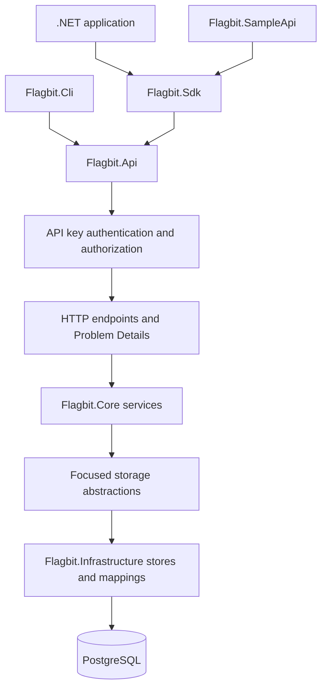
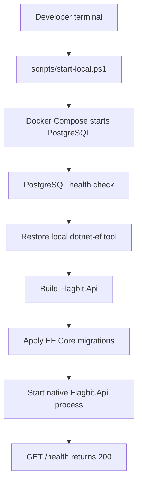
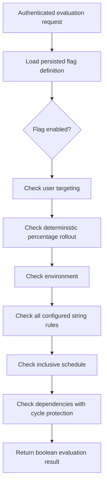

# Flow map

These maps describe the implemented ownership boundaries. The Mermaid diagrams use a linear curve, so every arrow is straight and points toward the next component or startup step.

## Runtime component flow

`Flagbit.Api` owns HTTP contracts, authentication, authorization, OpenAPI, health, and service composition. `Flagbit.Core` owns identifier validation, management behavior, and boolean evaluation semantics. `Flagbit.Infrastructure` owns PostgreSQL entities, mappings, normalization, and EF Core migrations.

The SDK is an independent HTTP client. It sends one request per evaluation, accepts a caller-owned `HttpClient` and context, and leaves variation selection and failure policy to the caller. The CLI is also an HTTP client. The SampleApi uses the SDK for one contextual evaluation per checkout request. None of these clients performs local flag evaluation, caching, retries, or outage fallback.

## Local startup flow

Docker is used only for PostgreSQL. The API, CLI, SDK consumer, and SampleApi remain native .NET processes. The startup script resolves the Compose PostgreSQL connection, applies migrations before API readiness, writes API logs under `artifacts/local`, and stops the API process it owns when its terminal closes. The PostgreSQL container and its volume remain available until they are stopped separately.

## Evaluation decision flow

Configured restrictions use AND semantics. A disabled or missing flag, an unmet restriction, or a dependency cycle returns `false`. Matching supports case-insensitive identifiers, user targeting, deterministic rollout buckets, environments, five string-rule operators, inclusive schedules, dependency chains, shared dependencies, and safe cycle handling.
