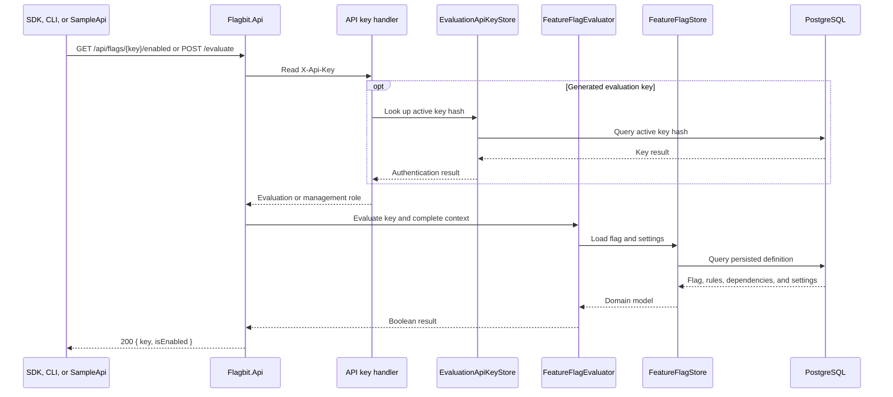
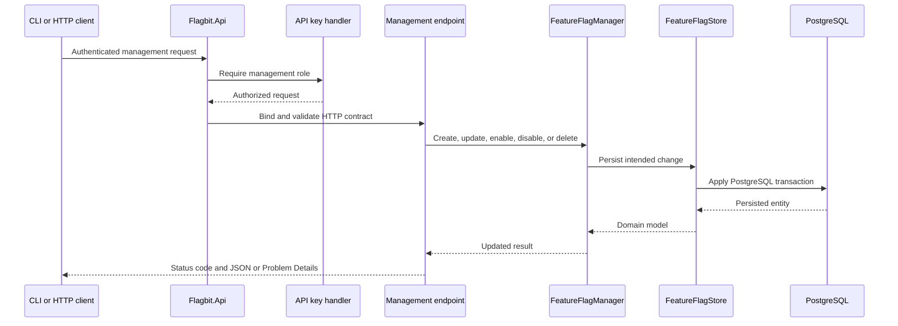
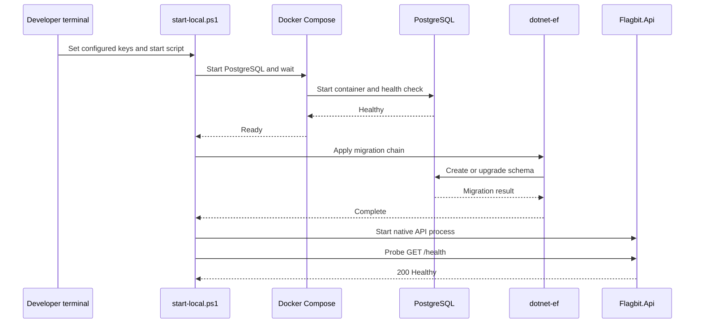

# Request map

This map follows the implemented HTTP paths. Sequence-diagram arrows are straight and show the request and response order.

## Evaluation request

The legacy GET endpoint accepts an optional `userId`. The contextual POST endpoint accepts `userId`, `environment`, and string attributes. Configured management and evaluation keys are checked from configuration; generated evaluation keys are hashed, stored in PostgreSQL, and checked on every request. Missing or invalid keys return `401`; an evaluation key used for management returns `403`.

## Management request

Management endpoints create, list, retrieve, enable, disable, replace evaluation settings, and delete flags. API-key management creates, lists, and revokes generated evaluation keys. Updating evaluation settings replaces the submitted child collections while unrelated flag fields remain preserved. Validation, conflicts, and not-found behavior use the documented status codes and Problem Details responses.

## Endpoint access map

| Path | Required access | Purpose |
| --- | --- | --- |
| `GET /`, `GET /health` | None | Service status and PostgreSQL connectivity. Health does not apply or validate migrations. |
| `GET /openapi/v1.json` | None in Development | Generated OpenAPI document. |
| `GET /api/flags/{key}/enabled` | Evaluation or management key | User-only boolean evaluation. |
| `POST /api/flags/{key}/evaluate` | Evaluation or management key | Complete-context boolean evaluation. |
| `GET /api/flags`, `GET /api/flags/{key}`, `POST /api/flags` | Management key | Flag retrieval and creation. |
| `PUT /api/flags/{key}/evaluation`, `/enable`, `/disable`; `DELETE /api/flags/{key}` | Management key | Evaluation-setting replacement and flag lifecycle changes. |
| `POST /api/keys`, `GET /api/keys`, `DELETE /api/keys/{id}` | Management key | Generated evaluation-key lifecycle. |

## Startup request

The script stops on Docker, tool-restore, build, migration, API-start, or health failures. It does not treat a reachable database as proof that migrations are current; migrations are applied before the health probe.
